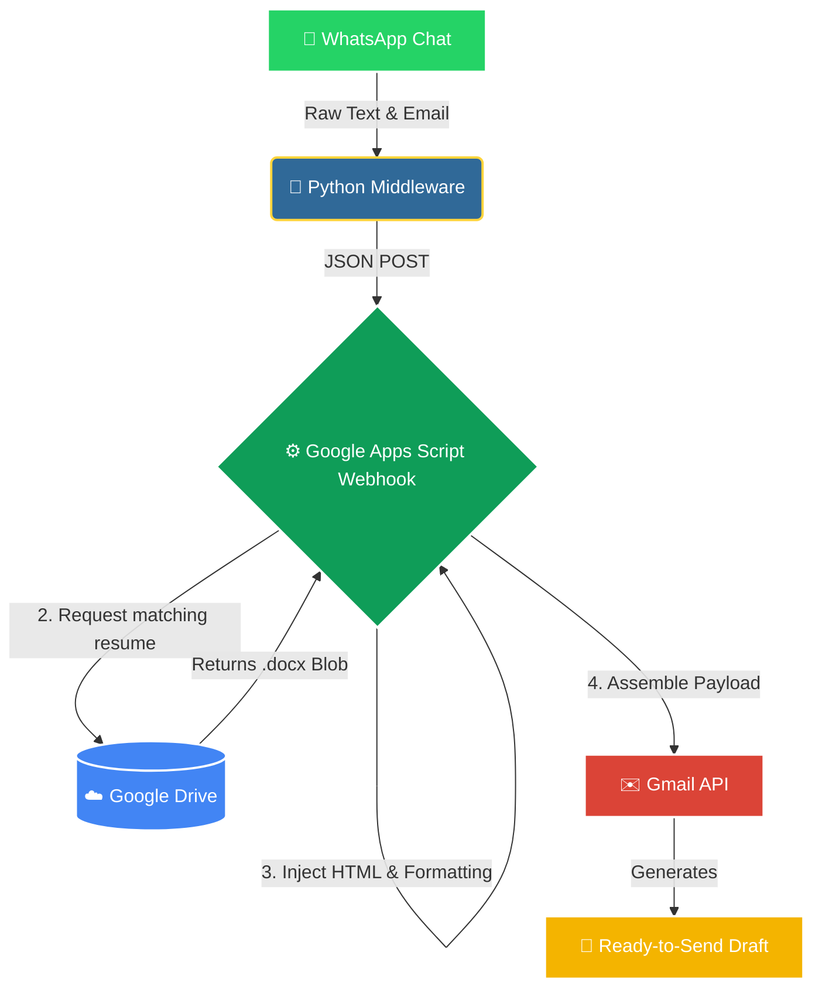

# 🚀 JobFlow Automation Pipeline

An automated pipeline that ingests job recruiter messages from WhatsApp, processes the text to extract key requirements, and dynamically generates highly customized Gmail drafts with the correct resume attached. 

Built to eliminate the manual overhead of applying for tech roles, this pipeline uses pattern recognition to ensure the right skills, format, and attachments are matched to every single opportunity.

## 🏗️ Architecture & Data Flow

## ✨ Key Features

* **Smart Subject Line Generator:** Extracts messy recruiter text (including emojis) and builds structured subject lines.
* **Dynamic Resume Routing:** Automatically selects from 9 different tailored resumes based on keyword triggers.
* **Auto-Formatting & Sanitization:** Strips emojis from the email body for professionalism while retaining them in the subject line.
* **Intelligent Name Extraction:** Parses the recruiter's email prefix to generate a personalized greeting.
* **HTML Email Templating:** Injects bolded keywords and a standardized signature into a clean formatting wrapper.
* **On-the-Fly File Conversion:** Pulls the correct Google Doc resume and attaches it as a standard `.docx` file.

## 🛠️ Tech Stack

* **Language:** Python 3.x, JavaScript (Google Apps Script)
* **APIs & Services:** Google Drive API, Gmail API, Google Web App Service

## 👨‍💻 Author
**Himavanth Mallela**  
Data Engineer | Cloud & Big Data Specialist